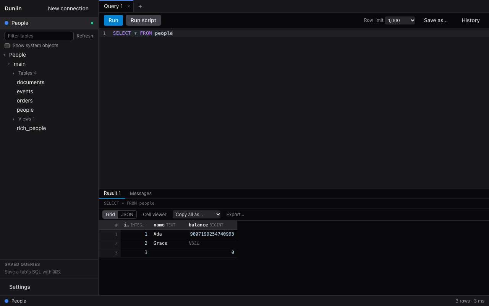
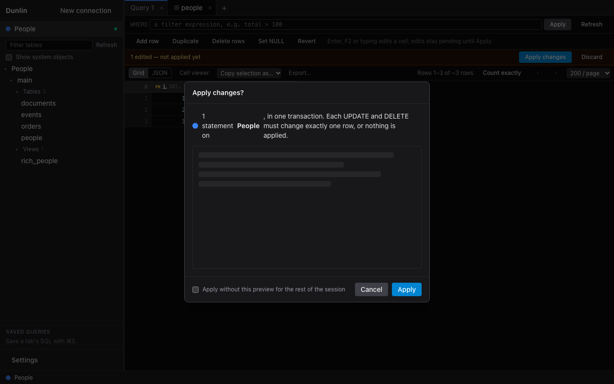
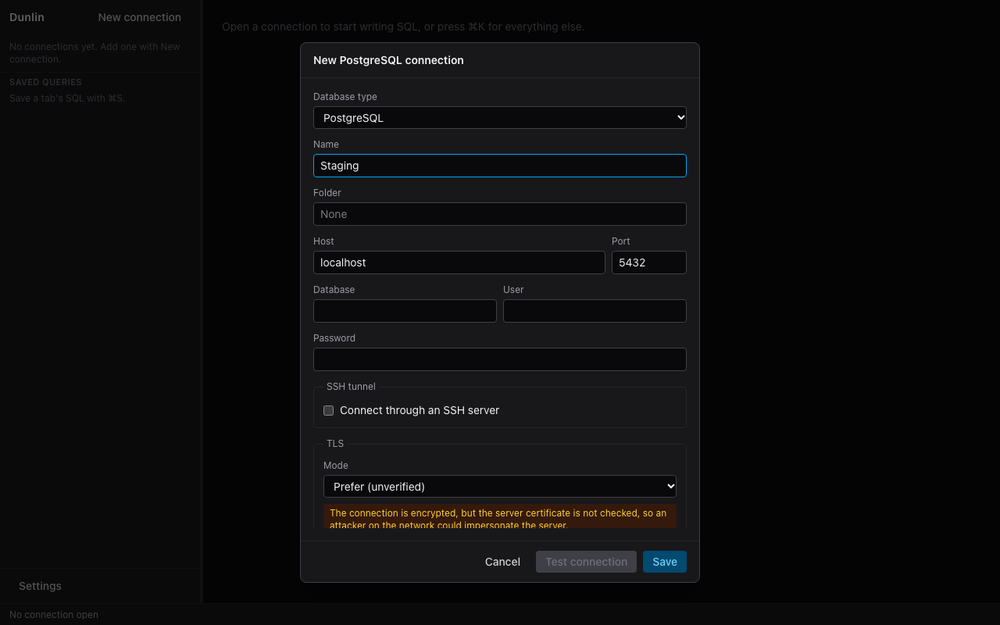

# Dunlin

A desktop database client written in Rust, in the spirit of DBeaver but much smaller.
Product name: **Dunlin**. Crate prefix `dbc-` (see DECISIONS D-012, D-014).

**Status:** all eight phases are implemented; release packaging (signed macOS build) and the acceptance run are in progress. See [docs/ROADMAP.md](docs/ROADMAP.md) and [CHANGELOG.md](CHANGELOG.md).



## What it does (v1)

- Connects to PostgreSQL, MySQL/MariaDB, SQLite and Redis/Valkey, directly or through an SSH tunnel.
- SQL editor with syntax highlighting and schema-aware autocomplete.
- Schema browser: tables, columns, indexes, constraints, DDL.
- Results as a grid or as JSON, with a viewer for JSON and XML cells.
- Inline editing, row insert and row delete, staged and previewed as SQL before applying.
- Export to CSV, JSON or `INSERT` statements, streamed so large tables keep memory flat.
- Saved queries, query history, a command palette and rebindable shortcuts.
- Restores its window, open connections and tabs on start.



## Install

Download the `.dmg` from the latest release, open it and drag Dunlin to Applications. Signed and notarised builds come from CI (Phase 8, task 8.20); until the first release, build from source:

```sh
pnpm --dir apps/desktop install
pnpm --dir apps/desktop tauri build          # app and dmg in target/release/bundle/
```

## First connection

1. Click **New connection** and pick the database type.
2. For SQLite, choose the file. For PostgreSQL or MySQL/MariaDB, enter host, port, database and user; the password is kept in the system keychain, never in Dunlin's own files.
3. Optional: under **SSH tunnel**, add the server (and a jump host if needed). The first time, Dunlin shows the server's key fingerprint and asks you to trust it.
4. **Test connection**, then **Save**. Click the connection in the sidebar to open it; ⌘↵ runs the statement under the cursor.

Mark production connections **Read-only** or **Always preview edits** to guard them; statements that change data without a `WHERE` always ask first.



## Stack

| Layer | Choice |
|---|---|
| Shell | Tauri 2 |
| Backend | Rust workspace (`crates/*`), tokio |
| Drivers | `tokio-postgres`, `mysql_async`, `rusqlite` |
| SSH | `russh` |
| Frontend | React + TypeScript + Vite, CodeMirror 6 |
| Local storage | SQLite file + OS keychain (`keyring`) |

## Documentation

Read in this order:

| Doc | Purpose |
|---|---|
| [docs/PRD.md](docs/PRD.md) | What we are building, for whom, and what is out of scope |
| [docs/ARCHITECTURE.md](docs/ARCHITECTURE.md) | Workspace layout, session model, query execution, storage |
| [docs/DRIVER_API.md](docs/DRIVER_API.md) | Driver traits, value model, schema model, change sets |
| [docs/IPC.md](docs/IPC.md) | Contract between the Rust backend and the frontend |
| [docs/SECURITY.md](docs/SECURITY.md) | Secrets, SSH host keys, TLS, production safeguards |
| [docs/TESTING.md](docs/TESTING.md) | Test strategy, tooling, coverage |
| [docs/DECISIONS.md](docs/DECISIONS.md) | Decision log (ADRs) |
| [docs/ROADMAP.md](docs/ROADMAP.md) | Phases, status, deferred features |
| [docs/phases/](docs/phases/) | One implementation brief per phase |

## Prerequisites

- Rust stable (edition 2024) with `rustfmt` and `clippy`
- Node 22+ and pnpm
- Docker (integration tests only)
- Tauri 2 system dependencies for your OS

## Commands

```sh
pnpm --dir apps/desktop tauri dev                           # run the app
cargo test --workspace                                      # unit tests
cargo test --workspace -- --ignored                         # integration tests (Docker)
cargo clippy --workspace --all-targets -- -D warnings
cargo fmt --all --check
pnpm --dir apps/desktop test                                # frontend unit tests
pnpm --dir apps/desktop lint
pnpm --dir apps/desktop e2e                                 # Playwright against the mocked backend
pnpm --dir apps/desktop gen:types                           # regenerate TypeScript IPC types
SCREENSHOTS=1 pnpm --dir apps/desktop exec playwright test readme-screenshots   # refresh README screenshots
```
